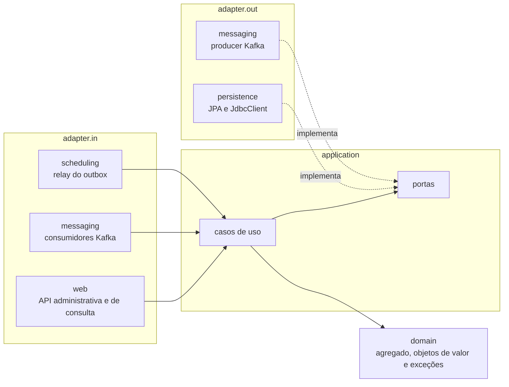
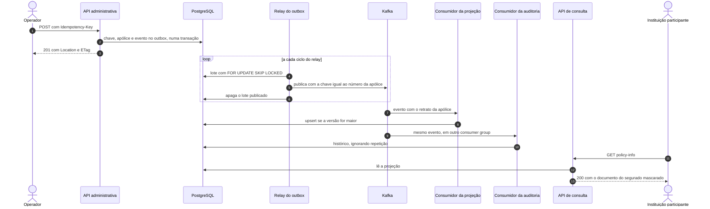

# Insureflow

API REST de apólices de seguro patrimonial, construída para um case técnico. Ela mantém um cadastro local de contratos, com identificação, vigência, produto, segurados e objetos segurados, e o expõe de duas formas: uma API administrativa própria, pela qual o backoffice emite, endossa e cancela apólices, e uma API de consulta inspirada na InsurancePatrimonial do Open Insurance Brasil. As escritas são extensões internas fictícias, sem equivalente na especificação oficial, e a consulta cobre o subconjunto documentado na seção 12, sem consentimento nem OAuth2. A solução não tem certificação nem aderência regulatória, e todos os dados são fictícios.

## Guia de leitura

- [1. Contexto](#1-contexto)
  - [1.1 Atores e responsabilidades](#11-atores-e-responsabilidades)
  - [1.2 Escopo](#12-escopo)
- [2. Stack](#2-stack)
- [3. Como rodar](#3-como-rodar)
  - [3.1 Pré-requisitos](#31-pré-requisitos)
  - [3.2 Execução](#32-execução)
  - [3.3 Inicialização do banco](#33-inicialização-do-banco)
  - [3.4 Build e testes](#34-build-e-testes)
  - [3.5 Endereços com a aplicação no ar](#35-endereços-com-a-aplicação-no-ar)
- [4. Arquitetura](#4-arquitetura)
  - [4.1 Camadas e pacotes](#41-camadas-e-pacotes)
  - [4.2 Caminho de uma escrita](#42-caminho-de-uma-escrita)
  - [4.3 Consistência entre as duas APIs](#43-consistência-entre-as-duas-apis)
- [5. Regras de negócio](#5-regras-de-negócio)
  - [5.1 Validação em duas camadas](#51-validação-em-duas-camadas)
  - [5.2 Invariantes](#52-invariantes)
  - [5.3 Identificadores imutáveis](#53-identificadores-imutáveis)
  - [5.4 Cancelamento e consulta de apólices canceladas](#54-cancelamento-e-consulta-de-apólices-canceladas)
- [6. API](#6-api)
  - [6.1 Rotas](#61-rotas)
  - [6.2 Semântica HTTP](#62-semântica-http)
  - [6.3 Envelope de erro e correlação](#63-envelope-de-erro-e-correlação)
  - [6.4 Contrato OpenAPI](#64-contrato-openapi)
- [7. Exemplo de ponta a ponta](#7-exemplo-de-ponta-a-ponta)
- [8. Decisões arquiteturais](#8-decisões-arquiteturais)
  - [8.1 PostgreSQL como banco](#81-postgresql-como-banco)
  - [8.2 Unicidade sob concorrência](#82-unicidade-sob-concorrência)
  - [8.3 Armazenamento e estratégia de consulta](#83-armazenamento-e-estratégia-de-consulta)
  - [8.4 Idempotência da emissão](#84-idempotência-da-emissão)
  - [8.5 Concorrência otimista no endosso](#85-concorrência-otimista-no-endosso)
  - [8.6 Outbox transacional](#86-outbox-transacional)
  - [8.7 Projeção e auditoria por eventos](#87-projeção-e-auditoria-por-eventos)
  - [8.8 Falhas e como cada etapa reage](#88-falhas-e-como-cada-etapa-reage)
- [9. Diferenciais](#9-diferenciais)
- [10. Observabilidade](#10-observabilidade)
- [11. Testes](#11-testes)
- [12. Mapeamento para o YAML oficial](#12-mapeamento-para-o-yaml-oficial)
  - [12.1 Rotas, parâmetros e cabeçalhos](#121-rotas-parâmetros-e-cabeçalhos)
  - [12.2 Campos do policy-info](#122-campos-do-policy-info)
- [13. Limitações](#13-limitações)
  - [13.1 Segurança e dados pessoais](#131-segurança-e-dados-pessoais)
  - [13.2 Eventos e consistência](#132-eventos-e-consistência)
  - [13.3 Modelo e API](#133-modelo-e-api)
  - [13.4 Execução e observabilidade](#134-execução-e-observabilidade)
- [14. Uso de IA](#14-uso-de-ia)

## 1. Contexto

A seguradora quer que os dados das apólices, que nasciam e morriam no backoffice, passem a ser lidos por outras instituições. Quando o dado deixa de ser interno, um erro de cadastro, como uma vigência invertida ou um LMI acima do LMG, vira informação errada publicada para o mercado. O desenho parte desse risco: as regras do contrato ficam no domínio e valem para qualquer entrada, a unicidade do número da apólice é decidida pelo banco, e cada mudança é gravada junto com o seu evento, de modo que uma queda do Kafka atrasa a consulta sem perder a escrita.

### 1.1 Atores e responsabilidades

| Ator | Papel | Por onde entra |
|---|---|---|
| Operador do backoffice | Único que altera dados: emite, endossa e cancela apólices | API administrativa |
| Instituição participante | Só consulta, no formato inspirado no Open Insurance | API de consulta |
| Segurado | Não usa o sistema, mas é o dono dos dados; o documento dele sai mascarado na consulta | Nenhuma |

### 1.2 Escopo

Entram o CRUD administrativo com persistência e regras, a listagem paginada e o policy-info no formato inspirado no Open Insurance, a publicação dos eventos de emissão, endosso e cancelamento no Kafka com dois consumidores locais, e a observabilidade local. Ficam de fora consentimento e OAuth2, os endpoints de prêmio e de sinistro, a autenticação da API administrativa e qualquer recurso de nuvem.

## 2. Stack

| Componente | Versão | Papel na solução |
|---|---|---|
| Java | 25 | Records nos objetos de valor e DTOs, pattern matching no `switch` que traduz exceções em status, virtual threads nos testes de concorrência |
| Spring Boot | 4.1.1 | Web MVC, Bean Validation, Actuator e integração com Docker Compose |
| Spring Data JPA e Hibernate | 4.1.1 e 7.4.5 | Persistência do agregado da apólice, com versão otimista |
| JdbcClient | Spring Framework 7.0.9 | SQL próprio do PostgreSQL: `ON CONFLICT`, `FOR UPDATE SKIP LOCKED` e upsert condicional |
| PostgreSQL | 17.6 | Apólices, chaves de idempotência, outbox, projeção e histórico |
| Flyway | 12.4.0 | Migrações versionadas, aplicadas na subida |
| Apache Kafka | 4.3.1, em KRaft | Tópico de eventos da apólice e tópico de dead letter |
| Spring for Apache Kafka | 4.1.1 | Producer idempotente, listeners concorrentes e roteamento para a dead letter |
| Jackson | 3.1.5 | JSON da API, do JSONB e dos eventos |
| springdoc-openapi | 3.1.1 | OpenAPI gerado pela aplicação, Swagger UI e Scalar |
| Micrometer e OpenTelemetry | 1.17.1 e 1.62.0 | Métricas e traces exportados por OTLP |
| grafana/otel-lgtm | 0.36.0 | Coletor OpenTelemetry, Prometheus, Tempo, Loki e Grafana num contêiner de desenvolvimento |
| JUnit, Testcontainers e Awaitility | 6.0.3, 2.0.5 e 4.3.0 | Testes de domínio, integração contra infraestrutura real e asserções assíncronas |
| Maven Wrapper | Maven 3.9.11 | Build sem Maven instalado |

A persistência usa JPA para o agregado, que é lido e gravado inteiro e aproveita a versão otimista do ORM, e SQL direto onde as regras dependem de cláusulas do PostgreSQL que o JPA não expressa: a fila do outbox, a gravação concorrente da chave de idempotência e os upserts da projeção e do histórico. Kafka atende ao diferencial de eventos do case, e a chave por número da apólice preserva a ordem de cada contrato dentro da partição.

## 3. Como rodar

### 3.1 Pré-requisitos

Java 25 e Docker com Compose em execução. O repositório traz o Maven Wrapper, então Maven não precisa estar instalado. As portas 8080, 5432, 9092, 3000, 4317 e 4318 precisam estar livres; a do PostgreSQL pode ser trocada num `.env` copiado do `.env.example`, que traz só credenciais fictícias de desenvolvimento.

### 3.2 Execução

```bash
./mvnw spring-boot:run
```

O Spring Boot lê o `compose.yaml`, sobe PostgreSQL, Kafka e a stack de observabilidade, espera os healthchecks e configura as conexões a partir dos contêineres; por isso a configuração da aplicação não traz URL de banco, de broker nem de OTLP. Ao encerrar a aplicação, os contêineres são parados.

### 3.3 Inicialização do banco

Na subida, o Flyway aplica as migrações de `src/main/resources/db/migration`, que criam as tabelas da apólice, das chaves de idempotência, do outbox, da projeção e do histórico, com as constraints descritas na seção 5. O Hibernate roda em modo `validate` e só confere o mapeamento contra o esquema. O banco começa vazio, sem seed, e os dados ficam num volume nomeado entre execuções. Para começar do zero:

```bash
docker compose down -v
```

### 3.4 Build e testes

```bash
./mvnw package -DskipTests
./mvnw verify
```

O `verify` compila e roda todos os testes. Ele precisa do Docker em execução, porque os testes de integração sobem PostgreSQL e Kafka reais pelo Testcontainers; a estratégia está na seção 11.

### 3.5 Endereços com a aplicação no ar

| Endereço | Conteúdo |
|---|---|
| http://localhost:8080/swagger-ui/index.html | Swagger UI com os dois grupos de API |
| http://localhost:8080/scalar | A mesma documentação no Scalar |
| http://localhost:8080/v3/api-docs/admin | OpenAPI da API administrativa |
| http://localhost:8080/v3/api-docs/open-insurance | OpenAPI da API de consulta |
| http://localhost:8080/actuator/health/readiness | Readiness, que depende só do PostgreSQL |
| http://localhost:3000 | Grafana, com o dashboard Insureflow provisionado |

## 4. Arquitetura

### 4.1 Camadas e pacotes

O domínio da apólice é Java puro, sem Spring, JPA, Jackson ou Bean Validation. A aplicação conhece só o domínio e a anotação de transação, com um caso de uso por operação e as portas de que cada um precisa. Os adapters de entrada e de saída dependem da aplicação e nunca uns dos outros. Os casos de uso são classes comuns, instanciadas na configuração de `infrastructure`, então a camada de aplicação não carrega anotações de componente do Spring.



```text
src/main/java/br/com/eduardoreche/insureflow
├── domain                agregado, objetos de valor, enums e exceções com código estável
├── application/policy    command, query, event, readmodel, audit e port
├── adapter/in            web (admin e openinsurance), messaging e scheduling
├── adapter/out           persistence e messaging
└── infrastructure        instância dos casos de uso, Kafka, tópicos e relógio
src/main/resources/db/migration   migrações Flyway
grafana                           dashboard provisionado pelo compose
docs/reference                    YAML oficial usado no mapeamento
```

### 4.2 Caminho de uma escrita

Uma emissão grava apólice, chave de idempotência e evento numa única transação e responde ao operador sem esperar o Kafka. O evento segue depois, pelo relay, até os dois consumidores.



### 4.3 Consistência entre as duas APIs

A API administrativa lê a tabela da apólice e vê sempre o estado confirmado. A API de consulta lê a projeção, então enxerga cada escrita com atraso. O atraso soma a espera pelo próximo ciclo do relay, o envio ao broker, o poll do consumidor e o upsert; uma métrica própria mede o tempo entre a mudança no domínio e a gravação na projeção, e o dashboard mostra média e máximo.

| Momento | API administrativa | API de consulta |
|---|---|---|
| Logo após a emissão | 200 com a apólice | 404 até a projeção receber o evento |
| Logo após um endosso | Nova versão | Versão anterior até a projeção receber o evento |
| Após o cancelamento | Status, motivo e data do cancelamento | O mesmo contrato, sem indicador de cancelamento |
| Kafka fora do ar | Escritas aceitas normalmente | Último retrato projetado, sem atualização até o broker voltar |

## 5. Regras de negócio

### 5.1 Validação em duas camadas

A borda HTTP barra formato com 400: campo obrigatório ausente, data ou enum inválido, valor fora do padrão de duas casas e campo desconhecido no corpo. As regras de negócio ficam nos construtores dos objetos de valor e da apólice e respondem 422 com código estável. Elas valem venha a entrada da API, de um evento lido do Kafka ou de uma linha carregada do banco, porque as três passam pelos mesmos construtores, e um objeto de valor inválido não chega a existir. As regras que dependem do conjunto, como o LMI de cada cobertura contra o LMG, ficam na raiz do agregado.

### 5.2 Invariantes

| Regra | Onde é aplicada | Resposta | Origem |
|---|---|---|---|
| Número da apólice único, inclusive sob concorrência | Índice único do banco | 409 `POLICY_DUPLICATE` | Case |
| Fim da vigência não anterior ao início, inclusiva nas duas pontas | Domínio e `CHECK` no banco | 422 `TERM_INVALID` | Case |
| Campos obrigatórios e formatos | Borda HTTP | 400 `INVALID_REQUEST` | Case |
| Identificadores imutáveis | Borda HTTP e mapeamento de persistência | 400 `INVALID_REQUEST` | Case |
| Apólice cancelada não aceita endosso | Domínio | 409 `POLICY_CANCELLED` | Adicional, sugerida pelo case |
| Vigência de cada cobertura contida na da apólice | Domínio | 422 `COVERAGE_OUTSIDE_TERM` | Adicional |
| LMI de cada cobertura até o LMG da apólice | Domínio | 422 `LMI_ABOVE_LMG` | Adicional |
| Data de emissão não futura, pelo relógio injetado no fuso de São Paulo | Domínio | 422 `ISSUANCE_IN_FUTURE` | Adicional |
| Identificador do certificado obrigatório para certificado e proibido nos outros tipos | Domínio | 422 `GROUP_CERTIFICATE_ID_MISMATCH` | Adicional |
| Ao menos um segurado e um objeto segurado, sem objeto repetido | Domínio | 422 `POLICY_WITHOUT_INSURED`, `POLICY_WITHOUT_OBJECT`, `OBJECT_DUPLICATED` | Adicional |
| Todo objeto com ao menos uma cobertura principal e sem cobertura repetida | Domínio | 422 `OBJECT_WITHOUT_COVERAGE`, `OBJECT_WITHOUT_MAIN_COVERAGE`, `COVERAGE_DUPLICATED` | Adicional |
| Cobertura OUTRAS exige descrição | Domínio | 422 `COVERAGE_DESCRIPTION_REQUIRED` | Adicional |
| Segurado não identificado por CNPJ exige data de nascimento | Domínio | 422 `INSURED_BIRTH_DATE_REQUIRED` | Adicional |
| Dinheiro não negativo e com até duas casas, rejeitado em vez de arredondado | Borda HTTP e domínio | 400, ou 422 `MONEY_NEGATIVE`, `MONEY_SCALE` | Adicional |
| Status coerente com motivo e data de cancelamento | Domínio e `CHECK` no banco | Sem resposta própria: o domínio nunca produz o estado inválido | Adicional |

### 5.3 Identificadores imutáveis

Os dados que identificam o contrato e a sua origem (número da apólice, proposta, tipo de documento, forma e data de emissão e certificado do grupo) não existem no corpo do endosso. Como a desserialização rejeita campo desconhecido, quem tenta mudá-los recebe 400 em vez de ver o campo ignorado em silêncio, e o mapeamento de persistência marca essas colunas como não atualizáveis. Não há caminho para alterá-los, nem com justificativa: corrigir uma proposta errada exige cancelar e reemitir, e em troca o mercado pode tratar esses identificadores como estáveis.

### 5.4 Cancelamento e consulta de apólices canceladas

Cancelar não apaga, porque a apólice vigorou, pode ter tido sinistro e precisa ser guardada. O cancelamento muda o status e registra motivo e instante, e uma constraint do banco amarra o status a esses dois campos. Ele é um `POST` num sub-recurso porque o pedido carrega o motivo e a resposta devolve a apólice na nova versão; um `DELETE` com 204 não teria onde levar o motivo e sugeriria remoção, e por isso responde 405. Sem corpo, o motivo registrado é OUTROS, e repetir o cancelamento devolve a apólice como está, sem mudar motivo nem data e sem gerar evento.

A apólice cancelada continua consultável nas duas APIs. A administrativa mostra status, motivo e data do cancelamento. A de consulta continua mostrando o contrato, sem campo de status, porque o esquema oficial do policy-info não tem um.

## 6. API

### 6.1 Rotas

| API | Método | Rota | Cabeçalho exigido | Sucesso |
|---|---|---|---|---|
| Administrativa | POST | `/api/v1/policies` | `Idempotency-Key` | 201, `Location` e `ETag` |
| Administrativa | GET | `/api/v1/policies/{policyId}` | | 200 e `ETag` |
| Administrativa | PATCH | `/api/v1/policies/{policyId}` | `If-Match` | 200 e `ETag` |
| Administrativa | POST | `/api/v1/policies/{policyId}/cancellation` | | 200 e `ETag` |
| Consulta | GET | `/insurance-patrimonial?page=1&page-size=25` | | 200 |
| Consulta | GET | `/insurance-patrimonial/{policyId}/policy-info` | | 200 |

### 6.2 Semântica HTTP

| Status | Quando |
|---|---|
| 400 | Corpo ilegível, campo desconhecido, formato inválido, cabeçalho ausente ou malformado, paginação fora dos limites |
| 404 | Apólice inexistente, ou ainda não projetada na API de consulta; rota inexistente |
| 405 | Método não suportado na rota, como `DELETE` numa apólice |
| 409 | Número de apólice já emitido; endosso de apólice cancelada |
| 412 | `If-Match` diferente da versão atual, ou versão alterada por outra escrita durante a transação |
| 415 | Corpo que não é JSON |
| 422 | Regra de negócio violada; `Idempotency-Key` reutilizada com outro corpo; endosso sem nenhum campo |
| 428 | Endosso sem `If-Match` |
| 500 | Falha inesperada, sem detalhe da causa na resposta |

A separação entre 400 e 422 acompanha as duas camadas de validação: 400 diz que o pedido não pôde ser lido, e 422 diz que foi lido e viola uma regra do contrato, código que o YAML oficial também prevê. O custo é um status a mais para o cliente tratar. Os status 412 e 428 vêm da concorrência otimista da seção 8.5.

### 6.3 Envelope de erro e correlação

As duas APIs devolvem erros no envelope do `ResponseError` do YAML, com um código estável em inglês e uma mensagem curta em português:

```json
{"errors":[{"code":"POLICY_VERSION_MISMATCH","title":"Pré-condição falhou","detail":"A apólice foi alterada desde a última leitura. Consulte-a novamente.","requestDateTime":"2026-10-25T02:59:05Z"}]}
```

O cabeçalho `x-fapi-interaction-id` vale para todas as rotas das duas APIs. Quando o cliente envia um UUID, a resposta o devolve; quando não envia, a API gera um; quando envia outra coisa, recebe 400 no mesmo envelope. O mesmo valor aparece em cada linha de log da requisição e no span correspondente.

### 6.4 Contrato OpenAPI

O OpenAPI gerado pela aplicação é o contrato completo, separado em dois grupos, administrativo e de consulta, com os endereços da seção 3.5. Cada operação documenta seus status, os cabeçalhos `ETag`, `Location`, `If-Match` e `Idempotency-Key` onde se aplicam, e exemplos de corpo. O envelope de erro e o `x-fapi-interaction-id` entram em todas as operações por configuração global, e uma rota nova herda o mesmo formato de erro na documentação. Um teste de contrato lê o documento gerado e envia à API o exemplo de emissão documentado.

## 7. Exemplo de ponta a ponta

Os comandos contam a vida de uma apólice, rodam em sequência num shell bash com a aplicação no ar e partem de um banco vazio. A API de consulta lê uma projeção alimentada por eventos, então os passos que a consultam esperam o evento chegar antes de seguir.

```bash
BASE=http://localhost:8080
POLICY=AP-2026-000123

cat > policy.json <<'EOF'
{
  "policyId": "AP-2026-000123",
  "documentType": "APOLICE_INDIVIDUAL",
  "issuanceType": "EMISSAO_PROPRIA",
  "issuanceDate": "2026-10-01",
  "termStartDate": "2026-10-01",
  "termEndDate": "2027-09-30",
  "maxLMG": "200000.00",
  "proposalId": "PROP-2026-000456",
  "productName": "Residencial Essencial",
  "insureds": [{
    "identification": "12345678901",
    "identificationType": "CPF",
    "name": "Maria Ficticia",
    "birthDate": "1990-05-17",
    "email": "maria@example.com",
    "address": {
      "streetType": "RUA",
      "streetName": "Rua Exemplo",
      "number": "100",
      "townName": "Sao Paulo",
      "state": "SP",
      "postCode": "01310100"
    }
  }],
  "insuredObjects": [{
    "identification": "IMOVEL-1",
    "propertyType": "CASA",
    "description": "Casa residencial",
    "postCode": "01310100",
    "coverages": [{
      "branch": "0118",
      "code": "INCENDIO",
      "susepProcessNumber": "15414.900000/2020-11",
      "lmi": "100000.00",
      "termStartDate": "2026-10-01",
      "termEndDate": "2027-09-30",
      "mainCoverage": true,
      "feature": "MASSIFICADOS",
      "type": "REGULAR_COMUM",
      "premiumPeriodicity": "ANUAL"
    }]
  }]
}
EOF

# Emissão: 201 com Location e ETag "0"
curl -si -X POST "$BASE/api/v1/policies" \
  -H 'Content-Type: application/json' \
  -H 'Idempotency-Key: emissao-AP-2026-000123' \
  --data @policy.json

# Mesma chave e mesmo corpo: devolve a resposta original sem emitir de novo
curl -s -X POST "$BASE/api/v1/policies" \
  -H 'Content-Type: application/json' \
  -H 'Idempotency-Key: emissao-AP-2026-000123' \
  --data @policy.json

# Consulta administrativa: estado confirmado, documento completo e ETag com a versão
curl -si "$BASE/api/v1/policies/$POLICY"

# Consulta Open Insurance: espera a projeção receber o evento
until curl -sf -o /dev/null "$BASE/insurance-patrimonial/$POLICY/policy-info"; do sleep 0.5; done
curl -s "$BASE/insurance-patrimonial/$POLICY/policy-info"

# Endosso sobre a versão lida: 200 e ETag "1"
curl -si -X PATCH "$BASE/api/v1/policies/$POLICY" \
  -H 'Content-Type: application/json' \
  -H 'If-Match: "0"' \
  -d '{"productName": "Residencial Plus", "maxLMG": "250000.00"}'

# Outro endosso sobre a versão antiga: 412
curl -s -X PATCH "$BASE/api/v1/policies/$POLICY" \
  -H 'Content-Type: application/json' \
  -H 'If-Match: "0"' \
  -d '{"productName": "Residencial Total"}'

# Tentativa de alterar um identificador: 400
curl -s -X PATCH "$BASE/api/v1/policies/$POLICY" \
  -H 'Content-Type: application/json' \
  -H 'If-Match: "1"' \
  -d '{"proposalId": "PROP-OUTRA"}'

# A consulta Open Insurance passa a mostrar o endosso quando o evento chega
until curl -s "$BASE/insurance-patrimonial/$POLICY/policy-info" | grep -q '"250000.00"'; do sleep 0.5; done
curl -s "$BASE/insurance-patrimonial?page=1&page-size=25"

# Cancelamento, a exclusão deste CRUD: 200, status CANCELLED e ETag "2"
curl -si -X POST "$BASE/api/v1/policies/$POLICY/cancellation" \
  -H 'Content-Type: application/json' \
  -d '{"reason": "PEDIDO_DO_SEGURADO"}'

# Endosso de apólice cancelada: 409
curl -s -X PATCH "$BASE/api/v1/policies/$POLICY" \
  -H 'Content-Type: application/json' \
  -H 'If-Match: "2"' \
  -d '{"productName": "Residencial Plus"}'

# A apólice cancelada continua consultável, com motivo e data do cancelamento
curl -s "$BASE/api/v1/policies/$POLICY"
```

## 8. Decisões arquiteturais

### 8.1 PostgreSQL como banco

PostgreSQL resolve com recursos próprios os pontos em que as regras dependem do banco: índice único para o número da apólice, `ON CONFLICT` para a chave de idempotência e o histórico, `FOR UPDATE SKIP LOCKED` para o relay de eventos, JSONB para as partes aninhadas do contrato, chave estrangeira verificada só no commit e `CHECK` repetindo regras do domínio.

H2 dispensaria o Docker, mas se comporta diferente justamente em locks e restrições, e os testes de concorrência passariam num banco que não é o de execução. Com DynamoDB, a unicidade sairia de escrita condicional e o outbox de streams, mas a listagem com total de registros e de páginas, que o `meta` do YAML pede, exigiria varrer a tabela. O custo da escolha é exigir Docker para rodar e para testar.

### 8.2 Unicidade sob concorrência

A unicidade do número da apólice fica no índice único, sem consulta prévia. Uma verificação antes do `INSERT` deixaria duas requisições simultâneas passarem juntas; com o índice, a segunda espera a primeira terminar e recebe a violação, que o adapter de persistência reconhece pelo nome da constraint e traduz para 409. Se a emissão perdedora já tinha gravado a chave de idempotência, o rollback a desfaz junto e nada chega ao outbox.

Um teste de integração dispara emissões paralelas do mesmo número com chaves de idempotência diferentes e confere que sai exatamente um 201, que os demais recebem 409 e que sobra uma única apólice no banco.

### 8.3 Armazenamento e estratégia de consulta

A apólice ocupa uma linha: identificação, vigência, LMG, produto e status em colunas, e segurados e objetos segurados, com as coberturas, em JSONB, já que o agregado é sempre lido e gravado inteiro e revalidado no domínio a cada carga. Cada apólice tem um UUID interno como chave primária, que não sai da persistência; eventos, projeção e histórico usam o número da apólice.

Tabelas filhas permitiriam consultar e restringir coberturas em SQL, ao custo de joins e de mais mapeamento. No modelo atual, o banco não enxerga dentro das coberturas, e renomear um campo de objeto de valor exige migrar o JSONB gravado.

A consulta administrativa busca pelo número da apólice no índice único. A API de consulta lê a projeção, cuja chave primária também é o número da apólice; o policy-info é uma leitura por chave, e a listagem ordena por esse número e pagina por deslocamento.

### 8.4 Idempotência da emissão

Idempotência e unicidade tratam problemas diferentes. A unicidade decide entre pedidos diferentes que disputam o mesmo número; a idempotência reconhece o mesmo pedido repetido, como o reenvio de quem não recebeu a resposta.

A emissão exige `Idempotency-Key`. Na mesma transação da apólice, o caso de uso grava a chave, o resultado e o hash SHA-256 do corpo desserializado e serializado de novo, que não muda com espaços ou ordem de campos. A chave é gravada antes da apólice, com `ON CONFLICT DO NOTHING`: uma requisição concorrente com a mesma chave espera na chave primária, lê o registro quando a primeira confirma e devolve a mesma resposta. A chave estrangeira para a apólice, verificada só no commit, permite gravar nessa ordem. A mesma chave com outro corpo recebe 422, e se a emissão falha a transação desfaz também a chave, então o cliente pode reenviar o pedido corrigido com ela.

Só a emissão pede chave porque é a única escrita que, repetida, criaria outro estado: o endosso é protegido pela versão, e o cancelamento repetido não muda nada. Uma chave opcional deixaria a proteção a critério do cliente. Os testes de integração disparam requisições paralelas com a mesma chave e conferem uma única apólice e a mesma resposta para todas, e um replay feito depois de um endosso continua devolvendo a resposta original.

### 8.5 Concorrência otimista no endosso

O endosso usa concorrência otimista com a versão da apólice exposta como `ETag`. O `PATCH` exige `If-Match`, responde 428 sem ele e 412 com uma versão diferente da atual. O caso de uso compara a versão antes de aplicar a mudança, e o ORM repete a comparação no `UPDATE`, o que fecha a janela entre a leitura e a gravação.

O custo é obrigar o cliente a ler antes de escrever, e o ganho é recusar um endosso calculado sobre dados velhos em vez de sobrescrever o de outro operador. O corpo traz só o que muda, e listas enviadas substituem as atuais por inteiro; um `PUT` de substituição completa obrigaria a reenviar identificadores que não podem mudar.

### 8.6 Outbox transacional

Cada emissão, endosso e cancelamento grava um evento numa tabela de outbox, na transação da mudança. Publicar no Kafka dentro da requisição derrubaria a API junto com o broker, e publicar depois do commit perderia o evento numa queda entre os dois passos. CDC com Debezium resolveria a captura sem polling, ao custo de mais um serviço para operar localmente.

Um job agendado lê lotes do outbox em ordem com `FOR UPDATE SKIP LOCKED`, publica e apaga as linhas na mesma transação, e instâncias concorrentes pegam lotes diferentes sem esperar umas pelas outras. A chave da mensagem é o número da apólice, então os eventos de um contrato caem na mesma partição e, com um único relay, em ordem; o producer é idempotente e espera a confirmação de todas as réplicas. Com o broker fora, o envio estoura o timeout do producer, a transação é desfeita e as linhas esperam o próximo ciclo, enquanto a API segue aceitando escritas; por isso o readiness depende só do PostgreSQL.

O preço é a entrega pelo menos uma vez, porque um lote enviado cuja transação falha sai de novo, e uma conexão presa enquanto o broker demora a responder. Apagar o que foi publicado mantém a tabela pequena e elimina o reprocessamento a partir dela. Um teste de integração pausa o contêiner do Kafka, emite uma apólice, confere o 201 e o readiness no ar e espera o outbox esvaziar quando o broker volta.

### 8.7 Projeção e auditoria por eventos

A API de consulta lê uma projeção própria. Ler a tabela da apólice direto daria consistência imediata, mas amarraria o contrato de mercado ao modelo de escrita; com a projeção, a leitura muda de forma ou de base sem tocar na escrita, ao preço da consistência eventual da seção 4.3.

O evento leva o retrato completo da apólice e a versão, e o consumidor da projeção faz um upsert que só substitui a linha quando a versão recebida é maior. Evento repetido ou atrasado não muda nada, e eventos de lotes diferentes que cheguem fora de ordem também se resolvem pela versão. Um evento com o retrato inteiro dispensa o consumidor de consultar a origem, ao custo de acoplar o formato do tópico aos objetos de valor do domínio.

A auditoria é outro consumer group, que grava tipo, versão e instante de cada evento num histórico chaveado pelo identificador do evento, sem dados pessoais, e ignora repetições. Gravar o histórico na transação da escrita o deixaria imediato e completo, ao custo de acoplar cada escrita a mais uma tabela; em group próprio, uma auditoria parada não atrasa o que o mercado vê, e o histórico fica eventual.

### 8.8 Falhas e como cada etapa reage

| Falha | O que acontece |
|---|---|
| Regra de negócio violada na emissão | 422; nada é gravado, nem a chave de idempotência |
| Número de apólice já emitido | 409; o rollback desfaz chave e evento |
| PostgreSQL fora do ar | 500 e readiness em DOWN, sem nada gravado |
| Kafka fora do ar | Escrita aceita; o evento espera no outbox e o relay tenta de novo no próximo ciclo |
| Envio concluído, mas a transação do relay falhou | O lote sai de novo; projeção e histórico ignoram a repetição |
| Mensagem ilegível ou que viola regra de domínio | Dead letter direto, sem novas tentativas, com log só do número da apólice |
| Falha transitória no consumidor, como banco fora | Duas novas tentativas, depois dead letter |
| Evento repetido, atrasado ou fora de ordem | A projeção ignora versão não maior, e o histórico ignora evento já gravado |

O consumidor aceita campos que não conhece, para o produtor evoluir sem quebrar quem lê; a API web faz o contrário e rejeita campo desconhecido, para que um pedido de alteração não passe com parte dele ignorada.

## 9. Diferenciais

| Diferencial do case | Situação | Como entrou | Evidência |
|---|---|---|---|
| Kafka com eventos de criação, alteração e cancelamento e consumidor local | Implementado | Outbox, relay e dois consumidores locais: projeção e auditoria | `PolicyEventFlowIntegrationTest` |
| SQS | Não usado | O Kafka cumpre o papel de mensageria | |
| LocalStack e Terraform | Não implementados | Nenhuma parte da solução depende de recurso AWS | |
| Logs estruturados e correlationId | Implementado | Logs JSON no formato ECS e `x-fapi-interaction-id` em MDC, log e span | `InteractionIdFilterTest` |
| Healthcheck | Implementado | Readiness com PostgreSQL e sem Kafka | `KafkaOutageIntegrationTest` |
| Métricas e tracing | Implementado | OTLP para a stack LGTM, métricas próprias e dashboard versionado | `PolicyOutboxMetricsTest`, `PolicyEventFlowIntegrationTest` |
| Docker Compose | Implementado | PostgreSQL, Kafka e LGTM sobem com a aplicação | Seção 3.2 |
| Testcontainers | Implementado | PostgreSQL e Kafka reais em todos os testes de integração | Seção 11 |
| Tratamento de concorrência | Implementado | Índice único, `ON CONFLICT` e `SKIP LOCKED` | `PolicyIdempotencyIntegrationTest`, `PolicyOutboxPersistenceAdapterTest` |
| Idempotência | Implementado | `Idempotency-Key` na emissão e consumidores idempotentes | `PolicyIdempotencyIntegrationTest`, `PolicyInfoViewPersistenceAdapterTest`, `PolicyEventHistoryPersistenceAdapterTest` |
| Versionamento otimista | Implementado | `ETag` e `If-Match` no endosso, mais a versão do ORM | `EndorsePolicyTest`, `PolicyControllerEndorseTest` |
| SOLID, Clean Architecture e Design Patterns | Aplicado onde há motivo | Portas e adapters, outbox, projeção de leitura, tolerant reader e dead letter | Seções 4 e 8 |

## 10. Observabilidade

A aplicação exporta traces e métricas por OTLP para a stack LGTM do compose. Requisições HTTP, envios ao Kafka e consumos viram spans sem código próprio, e a observação dos jobs agendados fica desligada, então os ciclos do relay não geram traces.

| Sinal | Como é produzido | Onde ver |
|---|---|---|
| Correlação | `x-fapi-interaction-id` recebido ou gerado, ecoado na resposta | Resposta, cada linha de log e atributo do span |
| Logs | JSON no formato ECS no console, com o documento do segurado mascarado | Console da aplicação |
| Traces | Spans automáticos de HTTP e Kafka | Tempo, pelo Grafana |
| `insureflow.outbox.pending` | Contagem de eventos esperando no outbox | Dashboard |
| `insureflow.policy.projection.delay` | Tempo entre a mudança no domínio e a gravação na projeção | Dashboard, com média e máximo |
| `insureflow.policy.events.dead_lettered` | Mensagens enviadas para a dead letter | Dashboard e log estruturado |
| Readiness | PostgreSQL disponível | `/actuator/health/readiness` |

O dashboard versionado em `grafana/` e provisionado pelo compose junta essas métricas a tráfego, erros 5xx, latência p95 e lag dos consumidores. O teste do fluxo de eventos percorre emissão, endosso e cancelamento e confere que documento e nome do segurado não aparecem na saída de log.

## 11. Testes

Os testes seguem as camadas. As afirmações de concorrência e resiliência deste README têm teste contra PostgreSQL e Kafka reais, pelo Testcontainers, com imagens fixadas na versão do compose.

| Nível | Como roda | O que prova | Exemplos |
|---|---|---|---|
| Domínio | JUnit puro, datas fixas, sem Spring | Cada invariante e cada código de erro, máscara do documento, escala do dinheiro | `PolicyTest`, `TermTest`, `MoneyTest`, `InsuredObjectTest` |
| Casos de uso | Portas implementadas em memória nos próprios testes | Replay e reuso de chave, comparação de versão, evento gravado com a versão salva, nada gravado quando a regra falha | `IssuePolicyTest`, `EndorsePolicyTest`, `CancelPolicyTest`, `RelayPolicyEventsTest` |
| Web | Fatias `@WebMvcTest` | Status, cabeçalhos, envelope de erro, `If-Match`, `Idempotency-Key`, interaction id e máscara na consulta | `PolicyControllerEndorseTest`, `PolicyInfoControllerTest`, `ApiExceptionHandlerTest` |
| Persistência | PostgreSQL real | Constraints, unicidade, upsert por versão, `SKIP LOCKED` entre relays, paginação | `PolicyPersistenceAdapterTest`, `PolicyOutboxPersistenceAdapterTest`, `PolicyInfoViewPersistenceAdapterTest` |
| Integração | Aplicação inteira com PostgreSQL e Kafka reais | Emissões concorrentes, fluxo até projeção e histórico, ordem por partição, dead letter sem vazamento, queda do broker, contrato OpenAPI | `PolicyIdempotencyIntegrationTest`, `PolicyEventFlowIntegrationTest`, `KafkaOutageIntegrationTest`, `OpenApiContractTest` |

## 12. Mapeamento para o YAML oficial

O YAML de referência está em `docs/reference/insurance-patrimonial.yaml`. O mapeamento vale para a saída da API de consulta; a API administrativa tem vocabulário próprio.

### 12.1 Rotas, parâmetros e cabeçalhos

| Elemento do YAML | Situação | Motivo |
|---|---|---|
| `GET /insurance-patrimonial` e `/{policyId}/policy-info` | Implementados | Consultas pedidas pelo case |
| `GET /{policyId}/premium` e `/claim` | Omitidos | Opcionais no case; prêmio e sinistro não fazem parte do modelo |
| `page` e `page-size` | Implementados | Mesmos nomes, padrões e limites |
| Envelope `data`, `links` e `meta` do policy-info | Adaptado: a apólice vem na raiz | Num recurso único sem consentimento, `links` e `meta` repetiriam a URL e o total 1 |
| `data` da listagem (`brand`, `companies`, `policies`) | Adaptado: lista direta de `policyId` e `productName` | Há uma única seguradora fictícia, e marca e sociedade seriam constantes |
| `meta` e `links` da listagem | `meta` implementado, `links` omitido | O cliente monta as páginas com `page` e `page-size` |
| `Authorization`, `x-fapi-auth-date`, `x-fapi-customer-ip-address`, `x-customer-user-agent`, `x-v`, `x-min-v` | Omitidos | Consentimento e OAuth2 estão fora do escopo, e a API tem uma única versão |
| `x-fapi-interaction-id` | Adaptado | Obrigatório no YAML; aqui é opcional, gerado quando ausente, ecoado, recusado com 400 quando não é UUID e aceito também na API administrativa |
| `ResponseError` | Implementado | Mesmo envelope nas duas APIs, sem o `meta` opcional |

### 12.2 Campos do policy-info

| Elemento do YAML | Situação | Motivo |
|---|---|---|
| `documentType` | Implementado | Só `APOLICE_INDIVIDUAL`, `BILHETE` e `CERTIFICADO`; os tipos de automóvel ficam fora do seguro patrimonial |
| `policyId`, `issuanceType`, `issuanceDate`, `termStartDate`, `termEndDate`, `proposalId` | Implementados | Campos recomendados pelo case |
| `groupCertificateId` | Implementado | Obrigatório para `CERTIFICADO` e proibido nos outros tipos |
| `maxLMG` | Implementado | `AmountDetails` com duas casas; a moeda é sempre `BRL` |
| `susepProcessNumber` da apólice | Omitido | O YAML só o exige para coberturas do ramo Garantia |
| `leadInsurerCode`, `leadInsurerPolicyId`, `coinsuranceRetainedPercentage`, `coinsurers` | Omitidos | O modelo não trata cosseguro além do tipo de emissão |
| `insureds` | Adaptado | `identification` sai mascarado, com só os dois últimos caracteres; `identificationTypeOthers` omitido; `birthDate` exigido fora de CNPJ, como o YAML condiciona |
| `Address` (`flagPostCode` e `oneOf`) | Adaptado | Só endereço nacional, com os campos de `NationalAddress` direto no objeto; `ibgeTownCode` omitido; `number` e `townName` sem os patterns do YAML |
| `beneficiaries`, `principals`, `intermediaries` | Omitidos | Fora do subconjunto pedido pelo case |
| `insuredObjects` | Adaptado | `identification`, `description`, `amount` e `coverages` implementados; `type` omitido, porque o enum descreve contrato, processo, automóvel ou pessoa e o imóvel já é descrito por `propertyType`, trazido de `branchInfo` junto com `postCode` |
| `branchInfo` | Adaptado | Só `propertyType` e `postCode`, dentro de cada objeto segurado; `basicCoverageIndex`, `structuringType` e `businessActivity` omitidos |
| Coberturas do objeto segurado | Implementado em parte | `branch`, `code`, `description`, `susepProcessNumber`, `LMI`, vigência, `isMainCoverage`, `feature`, `type` e `premiumPeriodicity`; `code` aceita um subconjunto do enum; `internalCode`, `isLMISublimit`, carência e `premiumPeriodicityOthers` omitidos |
| `coverages` da apólice (franquia e POS) | Omitido | Franquia e POS não fazem parte do modelo |

## 13. Limitações

### 13.1 Segurança e dados pessoais

- A API administrativa não tem autenticação, e a de consulta não implementa consentimento nem OAuth2.
- Os dados do segurado ficam completos na tabela da apólice, no outbox, no tópico, na dead letter e na projeção, sem criptografia. A máscara existe só na resposta da API de consulta e nos logs.
- Se uma constraint `CHECK` do banco disparar, o driver do PostgreSQL inclui a linha recusada na mensagem de erro, e o log do erro 500 levaria os dados do segurado. O domínio barra as mesmas regras antes, então isso só acontece se as duas camadas divergirem.

### 13.2 Eventos e consistência

- A dead letter não é reprocessada. A projeção do contrato se corrige no próximo evento dele, que traz o retrato completo, e a entrada correspondente do histórico se perde.
- Não há rotina para reconstruir a projeção, porque o outbox é apagado após a publicação e o tópico retém eventos por tempo limitado.
- A disputa entre dois endossos com o mesmo `If-Match` depende da comparação de versão do ORM e não tem teste próprio. Um cancelamento que perde essa disputa para um endosso recebe 412, mesmo sem ter enviado `If-Match`.
- A ordem dos eventos com mais de uma instância da aplicação não tem teste.

### 13.3 Modelo e API

- O policy-info mostra a apólice cancelada sem indicador de cancelamento, e nenhuma resposta diz se o contrato está em vigor pelas datas.
- Os registros de idempotência não expiram.
- A listagem pagina por deslocamento e conta o total a cada página.
- Todo valor monetário é gravado em reais, e cosseguro aceito é aceito sem os dados da seguradora líder que o YAML prevê.
- O banco sobe vazio, sem dados de exemplo carregados automaticamente.

### 13.4 Execução e observabilidade

- A execução documentada é pelo Maven. O jar empacotado não inclui a integração com o Compose e precisa receber as conexões por configuração, inclusive os endpoints OTLP.
- A stack LGTM é uma imagem de desenvolvimento, sem persistência, autenticação ou alta disponibilidade, e a amostragem de traces é de 100%.
- Os logs ficam no console e não vão para o Loki. Não há spans de SQL nem regras de alerta, e o Actuator usa a porta da API.
- O painel de dead letter mostra o total desde a subida da aplicação, sem janela de tempo.
- Uma emissão gera dois traces, o da requisição e o do envio ao Kafka com os consumidores, porque o contexto não atravessa o outbox; levá-lo numa coluna do outbox ficou de fora para manter o relay simples.

## 14. Uso de IA

Usei assistentes de IA como apoio durante o desenvolvimento: para prototipar tipos e DTOs a partir do YAML oficial, localizar os esquemas da especificação Open Insurance que interessavam ao subconjunto implementado, conferir nomes, enums e formatos contra o padrão do protocolo, redigir as descrições do OpenAPI e gerar trechos de código e de teste sob pedido explícito, revisados antes de entrar no repositório. A redação deste README também teve apoio de IA, a partir de um levantamento do código. As decisões de modelagem, os trade-offs e as limitações descritos aqui são meus, e consigo explicar cada arquivo do repositório.
